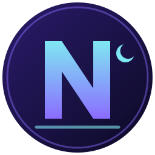

<p align="center"></p>

# Noxium (NOX)

<p align="center">
  <a href="https://safdar786kot.github.io/noxium/">Website</a> ·
  <a href="https://github.com/Safdar786kot/noxium/releases">Downloads</a> ·
  <a href="tools/deploy/README.md">Run a node</a> ·
  <a href="docs/LAUNCH.md">Launch plan</a> ·
  <a href="SECURITY_REVIEW.md">Security review</a>
</p>

> **Status:** public testnet (`v0.1.0-testnet`). Mainnet has not launched yet; testnet coins have no value.

Noxium is a private, limited-supply cryptocurrency forked from [Monero](https://github.com/monero-project/monero) (release-v0.18).
It keeps everything that makes Monero private — ring signatures (CLSAG, ring size 16), stealth addresses, RingCT with Bulletproofs+, view tags and RandomX CPU mining — but replaces Monero's perpetual tail emission with a **hard cap of 18,000,000 NOX**.

| | Monero | **Noxium** |
|---|---|---|
| Ticker | XMR | **NOX** |
| Max supply | unlimited (0.6 XMR/block tail emission) | **18,000,000 NOX (hard cap)** |
| Emission speed factor | 20 | **22** (smoother, Bitcoin-like curve) |
| Initial block reward | ~17.6 XMR | **~8.58 NOX** |
| Block time | 2 min | 2 min |
| Decimals | 12 | 12 (1 NOX = 10¹² piconox) |
| PoW | RandomX | RandomX (from block 1) |
| Address prefix | `4…` / `8…` | **`Nx…`** standard, **`Ni…`** integrated, **`Ns…`** subaddress |
| Testnet / stagenet addresses | `9…` / `5…` | `Tx…` / `Sx…` |
| P2P / RPC / ZMQ ports | 18080 / 18081 / 18082 | **17750 / 17751 / 17752** |
| Testnet ports | 28080-28082 | 27750-27752 |
| Stagenet ports | 38080-38082 | 37750-37752 |
| Data directory | `~/.bitmonero` | `~/.noxium` |
| Binaries | `monerod`, `monero-wallet-cli`, … | `noxiumd`, `noxium-wallet-cli`, `noxium-wallet-rpc`, … |
| Units | monero, millinero, … piconero | noxium, millinox, micronox, nanonox, piconox |
| URI scheme | `monero:` | `noxium:` |

## Emission schedule

The block reward is `(MONEY_SUPPLY − already_generated) >> 21` (for 2-minute blocks), so it decays smoothly and
**the total can never exceed 18,000,000 NOX**. There is no tail emission: when the cap is reached the reward is 0 and miners are paid by fees only.

| Milestone | Height | Time after launch |
|---|---|---|
| 50 % mined | 1,453,636 | ~5.5 years |
| 90 % mined | 4,828,871 | ~18.4 years |
| 99 % mined | 9,657,741 | ~36.7 years |
| 99.9 % mined | 14,486,611 | ~55 years |
| 100 % (last piconox) | 63,665,387 | ~242 years |

Reproduce with `python3 tools/rebrand/emission.py 18000000 22`.

Other supply-related consensus details:

* **No premine.** The genesis output (4.291534423828 NOX) is sent to a nothing-up-my-sleeve point: a public tag is hashed to a curve point and multiplied by 8. Nobody knows its private key, so the output can never be spent. These burned coins count toward the 18,000,000 NOX cap, so at most 17,999,995.708465576172 NOX can ever circulate.
* **Fee floor.** Monero derives the dynamic fee from the block reward. Once rewards shrink, Noxium uses `max(reward, 0.6 NOX)` as the fee reference so fees stay meaningful and spam stays expensive after emission ends.
* **Post-cap blocks.** A coinbase with zero reward and zero fees still gets one zero-value output, so empty blocks stay valid after the cap.

## What was changed from Monero

All changes are made by one reproducible script, [`tools/rebrand/rebrand.py`](tools/rebrand/rebrand.py). Run on a clean Monero v0.18 tree, it produces this repository. See `git log`: the first commit is untouched upstream Monero and the second commit is the rebrand.

* `src/cryptonote_config.h`: supply cap, emission factor, no tail emission, fee floor, coin name, address prefixes, ports, network IDs, new genesis transactions
* `src/cryptonote_basic/cryptonote_basic_impl.cpp`: capped `get_block_reward()`
* `src/cryptonote_core/cryptonote_tx_utils.cpp`: zero-reward coinbase support
* `src/cryptonote_core/blockchain.cpp`: fee floor
* `src/hardforks/hardforks.cpp`: new chain where only the genesis block is v1 and all v16 features (RandomX, CLSAG, Bulletproofs+, view tags) are active from block 1
* security fixes from the independent review (see [Security fixes](#security-fixes))
* `src/checkpoints`, `src/blocks`, `src/p2p`, `src/common/updates.cpp`: removed Monero checkpoints, seed nodes, DNS checkpoints and update checks
* user-facing names, units, URI scheme and binary names
* `assets/logo/`: Noxium logo (SVG, PNG 32–512 px, ICO)

### Making your own variant

Edit the `CONFIG` block at the top of `tools/rebrand/rebrand.py` (name, ticker, supply, emission speed, prefixes, ports, network IDs, genesis seed), then run it on a fresh Monero checkout:

```bash
git clone --recursive -b release-v0.18 https://github.com/monero-project/monero.git mycoin
python3 noxium/tools/rebrand/rebrand.py mycoin
```

To get address prefixes that start with other letters, use `tools/rebrand/find_prefix.py`.

## Building

Ubuntu/Debian dependencies:

```bash
sudo apt install build-essential cmake pkg-config libssl-dev libzmq3-dev libunbound-dev libsodium-dev \
  libunwind-dev liblzma-dev libreadline-dev libexpat1-dev libpgm-dev libhidapi-dev libusb-1.0-0-dev \
  libprotobuf-dev protobuf-compiler libudev-dev libboost-all-dev
```

Build:

```bash
mkdir -p build/release && cd build/release
cmake -DCMAKE_BUILD_TYPE=Release ../..   # add -DBUILD_TESTS=ON for unit tests
make -j$(nproc) daemon simplewallet wallet_rpc_server
# binaries end up in build/release/bin/
```

The git submodules (RandomX, supercop, rapidjson, trezor-common) are vendored in this repository, so no `git submodule update` is needed.

## Verification

These checks were run on this tree (Ubuntu 26.04, GCC, Boost 1.90):

* `tools/tests/run_supply_cap_test.sh` runs the compiled consensus `get_block_reward()` over the full emission. Results: block 1 (first v16) reward 8.583066801293 NOX, cap reached after 63,665,387 blocks, total emitted is exactly 18,000,000.000000000000 NOX, and the reward is 0 afterwards. **PASS**
* Mainnet node: new genesis loads and RandomX CPU mining works.
* Regtest end-to-end test: mined 120 blocks, sent 123.456 NOX from one wallet to another with ring size 16 (fee 0.0031 NOX), and the receiver's balance confirmed. Subaddresses start with `Ns…`, integrated addresses with `Ni…`, and payment URIs use `noxium:…`.

## Launching the network

```bash
# 1. first node (the seed)
./noxiumd --data-dir ~/.noxium --p2p-bind-port 17750 --rpc-bind-port 17751

# 2. create a wallet (address starts with "Nx")
./noxium-wallet-cli --generate-new-wallet ~/nox-wallets/main

# 3. mine with RandomX
#    inside noxiumd:  start_mining <your Nx… address> 2

# 4. other nodes join by pointing at the seed
./noxiumd --add-priority-node <seed-ip>:17750
```

## Pre-launch checklist status

| Item | Status |
|---|---|
| Own random network IDs and genesis seed | **Done.** New 16-byte `NETWORK_ID`s for mainnet/testnet/stagenet and a new `GENESIS_SEED`, all from a CSPRNG (see `CONFIG` in `tools/rebrand/rebrand.py`). Noxium nodes reject Monero peers, and the reverse. |
| Seed nodes | **Mechanism ready, list empty.** Fill `SEED_NODES` (IP:port), `DNS_SEEDS`, `TOR_SEEDS` and `I2P_SEEDS` in `CONFIG` with servers you run, then rerun the script and rebuild. Until then, nodes join with `--add-priority-node <ip>:17750`. |
| Own test network | **Done** (local 3-node testnet, see below). Before mainnet, run a public testnet on 2+ VPSs for a few weeks. |
| Independent security review | **Done**, see [SECURITY_REVIEW.md](SECURITY_REVIEW.md). All critical, high and low findings are fixed and re-reviewed. M2 remains a documented design decision. |
| Monero test suite | **Updated.** 1,272 unit tests pass (details below). |

### Testnet results

`tools/testnet/run_local_testnet.sh` starts 3 nodes, 3 wallet RPCs and 2 miners. `tools/testnet/soak.py` then checks every 30 s that all nodes agree, that emission equals the cap formula, and sends random transfers. Raw reports are in `docs/testnet/`.

* Heights 0 to 94, 225 consistency checks: **0 consensus mismatches**. Total emission matched `(MONEY_SUPPLY − generated) >> 21` to the piconox at every check.
* Block 0 is v1 (4.291534423828 NOX); block 1 is v16 (8.583066801293 NOX); RandomX is active from block 1.
* **50 transfers succeeded** with ring size 16, and fees were paid to miners.
* **Reorg test:** node c was isolated and mined its own 2-block branch while node a mined 5 blocks. After reconnecting, node c logged `REORGANIZE SUCCESS` and switched to the heavier chain. Wallets, emission and transfers stayed consistent afterwards.
* **Launch note:** a brand-new chain can't send transactions until there are enough unlocked outputs to fill a ring of 16. Coinbase outputs unlock after 60 blocks. On the testnet, transfers failed with "not enough outputs to use" until about block 76 and worked from then on. Plan for roughly 2.5–3 hours of mining (at 2-minute blocks) before the first transfer is possible.
* Bug found by the testnet and fixed: the wallet assumed one hard-fork table entry per version, and with the 1 → 16 jump it reported "Unexpected hard fork version". It now looks entries up by version.

### Security fixes

Every fix is made inside `rebrand.py` (section 6), so it is reproducible from a clean Monero tree:

* **C1 (critical):** removed Monero's hard-coded PoW hash and block-id exception for its block 202,612. Left in, they would have let any block pass PoW at that height, or halted the chain there. A unit test checks that the hash at 202,612 depends on the block.
* **H1:** only the genesis block is v1, and RandomX applies from block 1, so there is no CryptoNight window for an instamine.
* **M1:** the genesis output and tx key are nothing-up-my-sleeve points, so the genesis coins are provably burned. (Before, the private key could be derived from the public seed.)
* **M3:** alternative chains no longer count fees as emission.
* **L1–L6:**
  * no debug-assert abort after the cap;
  * Monero's Tor/I2P seeds and DNS blocklist removed;
  * own message-signing domain (`NoxiumMessageSignature`);
  * OpenAlias uses `oa1:nox` and accepts Noxium address lengths;
  * update checks are off by default;
  * Ledger/Trezor disabled, because their firmware only knows Monero.

**Open design decision (M2):** with no tail emission, the penalty for oversized blocks (which scales with the block reward) shrinks to zero once emission ends, around year 40+. Options:
* (a) a fee-based penalty against a reference reward, which is a consensus change;
* (b) accept fees-only security and monitor block growth;
* (c) a tiny tail emission, which breaks the hard cap.

This build ships (b). It must be decided long before the reward becomes negligible.

### Launch-day security (H1)

Small new chains are easy to attack with rented hashrate. Before announcing:
* publish the binaries and genesis hash in advance;
* have several independent miners ready at launch;
* run 3+ geographically separate seed nodes;
* add checkpoints (`CHECKPOINTS` in `CONFIG`) at regular intervals in the first releases;
* tell exchanges and users to wait for many confirmations at first.

### Test-suite status

`cmake -DBUILD_TESTS=ON`, then `make unit_tests` and run `build/release/tests/unit_tests/unit_tests`:
* 1,272 passed.
* Monero test vectors were converted to the same keys with Noxium prefixes by `tools/tests/convert_test_vectors.py`. The `monero:` URIs became `noxium:`, and `oa1:xmr` became `oa1:nox`.
* 4 are disabled because they need Monero's own chain or DNS: the `donate.getmonero.org` OpenAlias lookup, and three wallet fixtures created on Monero's testnet. One more (`Serialization.portability_wallet`) is skipped for the same reason.
* 1 fails: `http_server.response_soft_limit`. It's a generic Boost.Beast web-server test that the rebrand doesn't touch, most likely a Boost 1.90 compatibility issue.
* `boosted_tcp_server.shutdown` passes alone but can hang when run with the whole suite on a loaded 2-core machine.
* The new `noxium_consensus` tests cover C1, the hard-fork table and the genesis reward.
* `core_tests` and functional tests still use Monero's chain assumptions and have not been converted.

## License

Noxium is distributed under the same BSD-3-Clause license as Monero (see [LICENSE](LICENSE)).
Copyright (c) 2014-2022 The Monero Project. Portions Copyright (c) 2012-2013 The Cryptonote developers.
The original Monero README is kept in [docs/UPSTREAM_MONERO_README.md](docs/UPSTREAM_MONERO_README.md).
"Monero" is a trademark of the Monero Project; Noxium is an independent project and is not affiliated with or endorsed by it.
